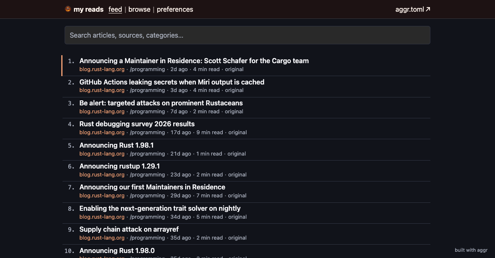
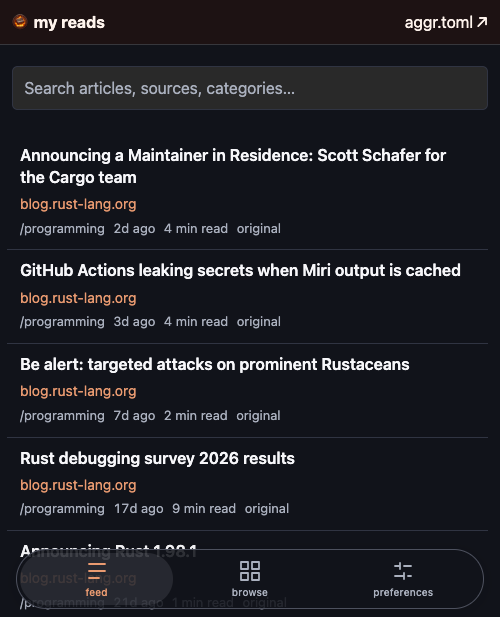

# aggr [](https://github.com/aymericbeaumet/aggr/actions/workflows/ci.yml)

[**Live demo**](https://aggr.aymericbeaumet.com) · [Create your reader](#create-your-reader)

Your own git-backed snapshot of the feeds you follow.

Give aggr a website URL. It finds the feed, saves each new item as Markdown in your Git
repository, and publishes a static site you can search and read on any device. The copy remains
after the original page is gone. The published site is static files.

<p>
  
  
</p>

## Create your reader

1. [Fork the working instance](https://github.com/aymericbeaumet/aggr-instance/fork), keeping
   **Copy the main branch only** selected to start without the demo's archive.
2. Replace `aggr.toml` with the [starter](examples/starter.toml) and edit the title and sources.
   A website URL is enough; aggr discovers the feed.
3. In **Settings → Pages → Build and deployment**, set **Source** to **GitHub Actions**.
4. Open **Actions**, enable workflows, and run **aggr** on `main`. The site is
   `https://<you>.github.io/<repo>/` until you set a domain.

Edit the configuration before the first run. The starter follows two sites and keeps each feed to
250 items, 730 days, and 1 GB, using the feed text and leaving images at the publisher.
Original-page extraction and local media are settings you turn on when you want them. The default
GitHub setup publishes the reader and its archive publicly. See [sources](docs/sources.md),
[hosting](docs/hosting.md), and [build budgets](docs/build-budget.md).

To try it on your machine:

```sh
mise use -g github:aymericbeaumet/aggr   # or download a binary from Releases
mkdir reads && cd reads && git init
aggr init
aggr dev                             # http://127.0.0.1:7319
```

`dev` does not commit or push.

## How is it different?

| Project | Focus |
|---|---|
| [Miniflux](https://miniflux.app) / [FreshRSS](https://freshrss.org) | A server that reads feeds for you. aggr stores the articles as files in Git and serves a static site. |
| [Bubo](https://github.com/georgemandis/bubo-rss) | One generated page of feed links. aggr also keeps the article text. |
| [wallabag](https://wallabag.org) | Pages you save, to read later. aggr follows sources on a schedule. |
| [ArchiveBox](https://github.com/ArchiveBox/ArchiveBox) | Broad snapshots of the web, including feeds. aggr is a reader whose history is Markdown in Git. |

## The archive is a Git branch

Configuration stays on your primary branch. Articles live on a separate `aggr` branch: one
Markdown file per item, with the original URL and the time it was first captured. A sync that
changes nothing creates no commit, and one broken source does not stop the others. Items copied
from another aggr repository keep their original links. See
[copying another instance](docs/sources.md#copying-another-aggr-instance).

```text
website URL → scheduled sync → Markdown on the aggr branch → static reader
```

An open feed picks up a finished deployment on its own. [Reading](docs/reading.md) covers search,
the phone layout, keyboard shortcuts, and offline copies. A stored item and the rules for editing
the branch are in the [Git model](docs/git-model.md). How large the public demo is, and how long a
run takes, is in [benchmarks](docs/benchmarks.md).

## Limits

- Reading state stays in the browser that recorded it.
- A capture keeps the article or the feed entry. Feed text can be a summary, and original-page
  extraction can fail. Video and audio still come from the publisher.
- A public site republishes what it captured. Pages ask search engines to skip them unless you
  opt in, and that request leaves a public repository public. The original link stays on every
  item. See [publication](docs/hosting.md#publication-and-search-indexing).
- Retention limits the current tree. Older commits remain for as long as that history is kept.
  See the [Git model](docs/git-model.md).

## Documentation

[Sources](docs/sources.md) · [Reader](docs/reading.md) · [Commands](docs/commands.md) ·
[Hosting](docs/hosting.md) · [Rendering](docs/rendering.md) · [Git model](docs/git-model.md) ·
[Interoperability](docs/interoperability.md) · [Performance](docs/performance.md)

Rust generates the site. The reader is a Svelte application compiled ahead of time and shipped
inside the binary, so building a site never needs Node. See [contributing](CONTRIBUTING.md) and
[client development](docs/client.md).

## License

[MIT](LICENSE), for every version published.
See [licensing](docs/licensing.md) for contribution terms and third-party notices.
