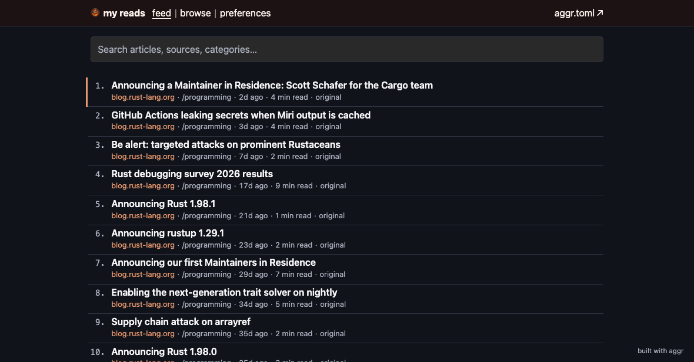
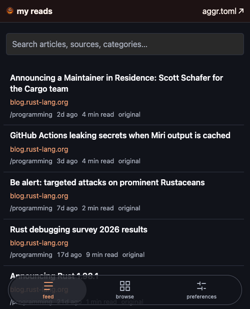

# aggr [](https://github.com/aymericbeaumet/aggr/actions/workflows/ci.yml)

[**Read the live demo**](https://aggr.aymericbeaumet.com) · [Try locally](#try-locally) · [Create your reader](#create-your-reader)

**A feed reader with a Markdown archive in Git.**

Give aggr a website URL. It finds the feed, saves each new item as Markdown in your Git
repository, and publishes a static site you can search and read on your phone or computer.
Keep the captured text after the original page disappears, inspect its history with Git, or
take the Markdown into another tool. The reader needs no database or always-running application
server; a scheduled job updates the archive and any static host can serve it.

<p>
  
  
</p>

## Try locally

With [mise](https://mise.jdx.dev/) and Git installed, create a small reader:

```sh
mise use -g github:aymericbeaumet/aggr@2.0.0
mkdir reads && cd reads && git init
aggr init
aggr dev
```

Open **http://127.0.0.1:7319**. `aggr init` writes a starter configuration; edit `aggr.toml` to
choose your sources. `aggr dev` previews the reader without committing or pushing. Stop with
Ctrl-C, then run `aggr build` to save articles on a local `aggr` branch and write the site to
`_site/`. A build also pushes the archive when an `origin` remote is configured.

The mise command installs a prebuilt binary. [Installation](docs/hosting.md#installing-the-binary)
also covers manual downloads, source builds, and platform requirements. You can
[browse the hosted demo](https://aggr.aymericbeaumet.com) without installing anything.

## Create your reader

1. [Fork the working instance](https://github.com/aymericbeaumet/aggr-instance/fork), keeping
   **Copy the main branch only** selected to start without the demo's archive.
2. Replace `aggr.toml` with the [starter](examples/starter.toml) and edit the title and sources.
   A website URL is enough; aggr discovers the feed.
3. In **Settings → Pages → Build and deployment**, set **Source** to **GitHub Actions**.
4. Open **Actions**, enable workflows, and run **aggr** on `main`. The site is
   `https://<you>.github.io/<repo>/` until you set a domain.

Edit the configuration before the first run. The starter follows two sites and keeps each feed to
250 items, 730 days, and 1 GB, using the feed text and leaving images at the publisher.
Original-page extraction and local media are settings you turn on when you want them. The default
GitHub setup publishes the reader and its archive publicly. See [sources](docs/sources.md),
[hosting](docs/hosting.md), and [build budgets](docs/build-budget.md).

For the contributor preview with fast template reload and automatic Rust restarts, follow the
mise setup in [contributing](CONTRIBUTING.md), then run `mise run dev` from this repository;
see [client development](docs/client.md). The source build also supports `aggr dev --demo`,
which uses an isolated OS cache. That flag is not available in the published v2.0.0 binary.

Rust applications can use [`aggr-lib`](crates/aggr-lib/README.md), the library behind the CLI,
as a path dependency from this checkout until its first crates.io publication.

## How is it different?

| Project | Focus |
|---|---|
| [Miniflux](https://miniflux.app) / [FreshRSS](https://freshrss.org) | A server that reads feeds for you. aggr stores the articles as files in Git and serves a static site. |
| [Bubo](https://github.com/georgemandis/bubo-rss) | One generated page of feed links. aggr also keeps the article text. |
| [wallabag](https://wallabag.org) | Pages you save, to read later. aggr follows sources on a schedule. |
| [ArchiveBox](https://github.com/ArchiveBox/ArchiveBox) | Broad snapshots of the web, including feeds. aggr is a reader whose history is Markdown in Git. |

## The archive is a Git branch

Configuration stays on your primary branch. Articles live on a separate `aggr` branch: one
Markdown file per item, with the original URL and the time it was first captured. A sync that
changes nothing creates no commit, and one broken source does not stop the others. Items copied
from another aggr repository keep their original links. See
[copying another instance](docs/sources.md#copying-another-aggr-instance).

```text
website URL → scheduled sync → Markdown on the aggr branch → static reader
```

An open feed picks up a finished deployment on its own. [Reading](docs/reading.md) covers search,
the phone layout, keyboard shortcuts, and offline copies. A stored item and the rules for editing
the branch are in the [Git model](docs/git-model.md). How large the public demo is, and how long a
run takes, is in [benchmarks](docs/benchmarks.md).

## Limits

- Reading state stays in the browser that recorded it.
- A capture keeps the article or the feed entry. Feed text can be a summary, and original-page
  extraction can fail. Video and audio still come from the publisher.
- A public site republishes what it captured. Pages ask search engines to skip them unless you
  opt in, and that request leaves a public repository public. The original link stays on every
  item. See [publication](docs/hosting.md#publication-and-search-indexing).
- Retention limits the current tree. Older commits remain for as long as that history is kept.
  See the [Git model](docs/git-model.md).

## Documentation

[Sources](docs/sources.md) · [Reader](docs/reading.md) · [Commands](docs/commands.md) ·
[Hosting](docs/hosting.md) · [Rendering](docs/rendering.md) · [Git model](docs/git-model.md) ·
[Interoperability](docs/interoperability.md) · [Performance](docs/performance.md) ·
[Sharing a reader](docs/sharing.md) · [Releases](docs/distribution.md)

Rust prepares the archive and renders a shared Svelte application embedded in the binary.
Cargo builds the UI automatically with the native Rust toolchain. See [contributing](CONTRIBUTING.md) and
[client development](docs/client.md).

## License

[MIT](LICENSE), for every version published.
See [licensing](docs/licensing.md) for contribution terms and third-party notices.
